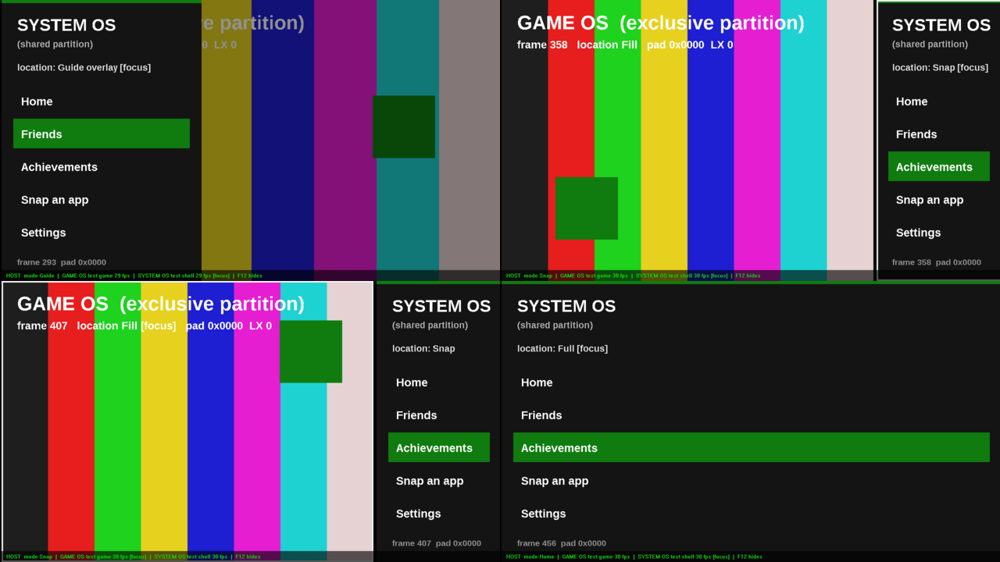

# Crimson: an Xbox One-style three-OS prototype on Windows

The Xbox One runs three Windows-kernel operating systems at once: a **host OS**
(the Hyper-V root) that owns the hardware, an **Exclusive partition** that runs
the game, and a **Shared partition** that runs the dashboard, Guide and snapped
apps. The host composites the two and decides which one gets the controller.

Crimson rebuilds that split on an ordinary Windows PC:

| Xbox One            | Crimson                                    | Runs                         |
|---------------------|--------------------------------------------|------------------------------|
| Host OS             | your Windows install + `crimson-host.exe`  | owns pad, Xbox button, screen |
| Exclusive partition | **Game OS**: `Crimson-Game` Hyper-V VM      | the game + `crimson-agent`   |
| Shared partition    | **System OS**: `Crimson-System` Hyper-V VM  | the shell + `crimson-agent`  |
| VMBus channels      | Hyper-V sockets (`AF_HYPERV`)              | frames up, input/layout down |

See [ARCHITECTURE.md](ARCHITECTURE.md) for the design and how it maps onto the
console.

## Try it in two minutes (process mode, any Windows 10/11)

No VMs: the host and the two partitions run as processes on one PC, talking
over TCP on 127.0.0.1:7700. Same protocol as the VM mode.

1. Double-click **`Run test partitions.cmd`**. A host window opens with a
   test Game OS and a test System OS.
2. Try the gestures:

| Controller             | Keyboard (host window focused) | What happens                                    |
|------------------------|--------------------------------|-------------------------------------------------|
| Xbox button tap        | Home                           | Guide overlay on/off. In Snap, swaps focus      |
| Xbox button hold       | End                            | Home: System OS full screen, game constrained   |
| Xbox button + RB       | F2                             | Snap on/off (System OS takes the right quarter) |
| everything else        | arrows, Enter, Backspace, X, Y | goes to the focused partition only              |
|                        | F12 / Shift+Esc                | HUD on/off / quit                               |

To use the Blades dashboard + Guide from `standalone-guide` as the System OS
shell, run `Run Blades as System OS.cmd "C:\path\to\Blades-Dashboard.exe"
["part of a game's window title"]`.

## Real partitions (VM mode, Windows Pro/Enterprise/Education)

1. Turn on Hyper-V and reboot:
   `Enable-WindowsOptionalFeature -Online -FeatureName Microsoft-Hyper-V-All`
2. Make one Windows VHDX (install Windows once in a plain VM).
3. In an elevated PowerShell:
   `hyperv\New-CrimsonPartitions.ps1 -BaseVhdx D:\VMs\win11-base.vhdx`
   This creates `Crimson-Game` (6 cores, 8 GB, 80% GPU partition) and
   `Crimson-System` (2 cores, 3 GB, 20% GPU partition) as differencing disks,
   copies the host GPU driver in for GPU-P, installs the agent with a startup
   entry, and registers the Hyper-V socket service.
4. Boot each VM once and run `C:\Crimson\Setup-Guest.ps1 -User <u> -Password 
`.
5. `build\crimson-host.exe --hv`, then `Start-VM Crimson-System, Crimson-Game`.

## Build

`./build.sh` (MinGW-w64 on Linux or MSYS2). Output: `build/crimson-host.exe`,
`build/crimson-agent.exe`. Plain C and Win32, no dependencies.
