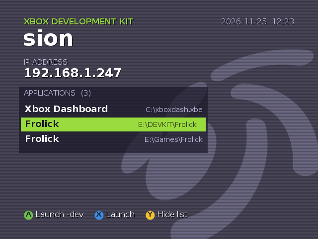

# Devkit dashboard

A dashboard for the Sion in the manner of the XDK's devkit launcher: a
background picture, the console's host name and IP address drawn with
XFONT, and an optional list of the titles on the hard disk that A launches
with a developer command line. It boots in place of the Xbox dashboard
when `/etc/default/xbox` says `XBOX_DASH=devkit`; the Xbox dashboard stays
installed and is the first entry in the list.

It is an ordinary XDK title (`src/devkitdash.cpp`, one file), shaped after
KeybadeBlox's Xbox Demos decompilation (xdemos-decomp): one loop that reads
the pads, redraws what changed and swaps. The whole screen is composed on
the CPU into one 640x480 canvas: the background, the panels, and XFONT's
text, which XFONT draws antialiased into an A8 buffer
(`XFONT_TextOutToMemory`) and the dashboard blends in its colour. The canvas
goes into a linear texture only when something on it changed, and is drawn
as one quad every frame. It links the XDK's `xfont.lib`, `d3d8`,
`xgraphics` and `xapilib` from the leak.

| What | How |
|---|---|
| Host name and IP | `E:\DEVKIT\hostinfo.txt` (`name=`, `ip=`, `if=` lines), which `xbox-hostinfo` (bootani/buildroot/package/xbcompat) rewrites every 5 s while the session runs it; reread every 2 s. These are the Sion's own name and addresses, not xbcompat's emulated network card's. |
| Titles | `C:\xboxdash.xbe`, the disc (`\Device\CdRom0\default.xbe`), `E:\Games\*\default.xbe`, `E:\Apps\*\default.xbe`, every `.xbe` in `E:\DEVKIT\*\`; names from each XBE's certificate; rescanned every 2 s |
| A | `XWriteTitleInfoAndReboot` with `LDT_FROM_DEBUGGER_CMDLINE` and the command line from `E:\DEVKIT\devkit.ini` (`cmdline=`, default `-dev`): what a devkit's debugger hands a title. xbcompat logs it on launch ("launched with a debugger command line"). |
| X | the same launch with no launch data |
| Y | hides or shows the list (`launcher=` in devkit.ini) |
| Xbox Dashboard | writes `E:\DEVKIT\run-xboxdash` and returns to firmware; `xbox-session` runs the stock dashboard once, exactly as it does without the devkit dashboard, with the soft reset on so L + R + Back + Start comes back |

Title ID FFFE0000 like the other dashboards, so xbcompat doesn't offer the
soft reset or the Guide over it.

## Build and run in the cloud

    tools/devkitdash/build.sh [WORK]    # VC7 + imagebld under Wine, as dashbuild does
    tools/devkitdash/run.sh [WORK] [xbcompat options...]
    tools/devkitdash/mkkit.sh [WORK]    # the Sion kit, dist/sion

`run.sh` runs it the way the Sion's session does, with `xbox-hostinfo`, and
runs the stock dashboard when asked if `DASHWORK` points at a
`tools/dashbuild` work directory. `BG=picture.png build.sh` builds with
another background (`tools/mkbg.py` crops it to 4:3 and scales it to
640x480).

Wine 9 in the cloud container crashes at start ("free(): invalid pointer")
unless it is pointed at its server:
`WINEARCH=win32 WINESERVER=/usr/lib/wine/wineserver32 XDG_RUNTIME_DIR=/run/user/0`.

## On the Sion

`dist/sion` is the kit (see its README): `sh sion-devkit.sh` installs it and
restarts into it, `sh sion-devkit.sh revert` boots the Xbox dashboard
again. New images built with `tools/sion/bundle.sh` carry it in
`C:\devkit` already; only `XBOX_DASH=devkit` is needed.
